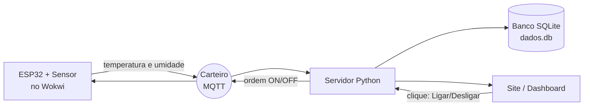

# 🌡️ Monitor de Ambiente IoT

Projeto do **Tema Integrador IV – Internet das Coisas (IoT)** · Curso de ADS

## O que é este projeto? (explicação para qualquer pessoa)

Imagine um **termômetro inteligente** que:

1. **Mede** a temperatura e a umidade de uma sala.
2. **Envia** essas medidas pela internet, sozinho, a cada 5 segundos.
3. **Guarda** tudo num "caderno digital" (o banco de dados).
4. **Mostra** os números e um gráfico num **site**.
5. Permite **ligar e desligar um ventilador** pelo site, de longe.

É isso. Simples assim.

## As 4 peças do sistema

| Peça | O que é | Analogia do dia a dia |
|---|---|---|
| **ESP32 + sensor DHT22** | Uma plaquinha com um sensor de temperatura e umidade | Os "olhos" que observam a sala |
| **LED azul** | Representa o ventilador (aceso = ligado) | O "braço" que age |
| **MQTT (broker HiveMQ)** | Um serviço gratuito que entrega mensagens | O **carteiro** |
| **Servidor Python + SQLite** | Programa que recebe, guarda e mostra os dados | A **secretária** com seu caderno |
| **Site (dashboard)** | Página com números, gráfico e botões | O **painel** do carro |



> Não temos hardware físico: o ESP32 roda no **Wokwi**, um simulador gratuito no navegador. Funciona igual a uma placa de verdade.

## Como rodar (passo a passo)

### Parte 1 – O servidor (no seu computador)

Precisa ter o **Python 3** instalado ([python.org](https://www.python.org/downloads/) – na instalação marque "Add Python to PATH").

Abra o terminal (Prompt de Comando) dentro da pasta `backend` e digite:

```bash
pip install -r requirements.txt
```

```bash
python app.py
```

Vai aparecer: `Conectado ao broker MQTT! Aguardando dados do ESP32...`
Abra o navegador em **http://localhost:5000**. O site aparece (ainda sem dados).

**Deixe o terminal aberto.** Se fechar, o servidor para.

### Parte 2 – O ESP32 (no simulador Wokwi)

1. Acesse [wokwi.com](https://wokwi.com) → **New Project** → **ESP32**.
2. Na aba **sketch.ino**: apague tudo e cole o conteúdo de `firmware/sketch.ino`.
3. Na aba **diagram.json**: apague tudo e cole o conteúdo de `firmware/diagram.json`.
4. Clique na setinha ao lado das abas → **New file** → nome `libraries.txt` → cole o conteúdo de `firmware/libraries.txt`.
5. Clique no botão verde ▶️ **Play**.

No terminal do Wokwi aparece `Enviado: {"temp": 26.0, "umid": 55.0}`.
Em poucos segundos os números aparecem no site.

### Parte 3 – Testando

- **Mudar a temperatura:** no Wokwi, clique no sensor DHT22 (peça branca) e arraste as barrinhas. O gráfico do site muda.
- **Ligar o ventilador:** clique em **Ligar** no site. O LED azul acende no Wokwi.
- **Desligar:** clique em **Desligar**. O LED apaga.

## Estrutura das pastas

```
projeto-iot/
├── README.md                ← você está aqui
├── firmware/                ← código que roda no ESP32
│   ├── sketch.ino           ← o programa
│   ├── diagram.json         ← o desenho do circuito
│   └── libraries.txt        ← bibliotecas que o Wokwi precisa baixar
├── backend/                 ← o servidor e o site
│   ├── app.py               ← o programa do servidor
│   ├── requirements.txt     ← lista do que instalar no Python
│   └── templates/index.html ← a página do site
└── docs/                    ← documentos das entregas
    ├── entrega1-concepcao.md
    ├── entrega2-borda.md
    ├── entrega3-web.md
    └── entrega4-relatorio-final.md
```

## Problemas comuns

| Problema | Solução |
|---|---|
| `pip` ou `python` "não reconhecido" | Reinstale o Python marcando **Add Python to PATH** |
| Site abre mas sem números | Verifique se o Wokwi está rodando (▶️) e se o `app.py` está aberto |
| Wokwi fica em "Conectando ao broker..." | Internet instável ou broker fora do ar; espere e dê Play de novo |
| Erro "Erro ao ler sensor" | Confira o `diagram.json` – o fio do sensor deve ir no pino 15 |
| Quero apagar os dados | Feche o `app.py` e apague o arquivo `backend/dados.db` |

## Tecnologias

ESP32 (Wokwi) · C++/Arduino · MQTT (HiveMQ público) · Python · Flask · SQLite · HTML + Chart.js
