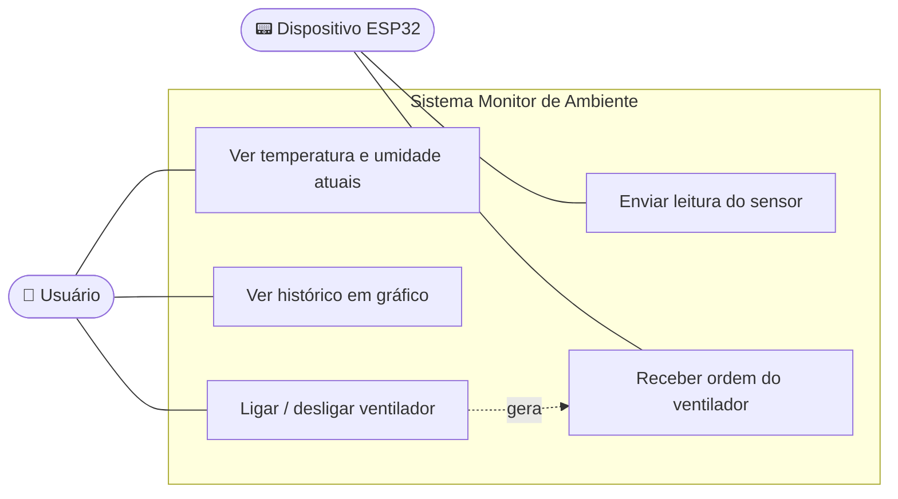
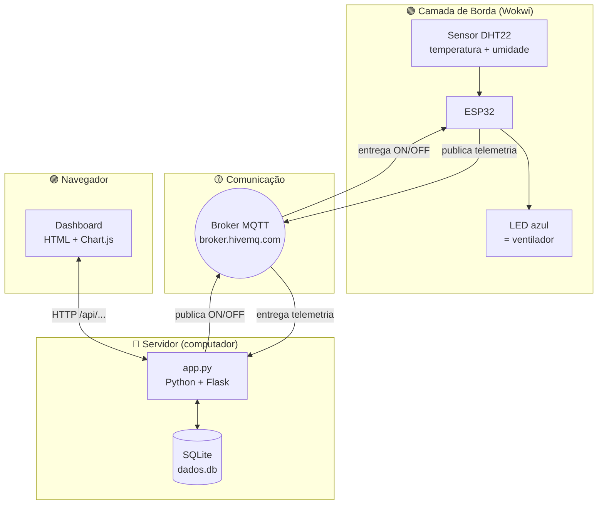

# Entrega 1 – Concepção e Modelagem

## 1. O problema

Salas de aula, escritórios e quartos ficam quentes e abafados sem que ninguém perceba a tempo. Isso causa desconforto, cansaço e queda de concentração. Normalmente não há como **acompanhar a temperatura de longe** nem **agir à distância** (ligar um ventilador, por exemplo).

## 2. A solução (escopo)

Um sistema simples de IoT que:

- **mede** temperatura e umidade a cada 5 segundos;
- **guarda** cada medida num banco de dados;
- **mostra** os valores atuais e um gráfico num site;
- **permite ligar/desligar** um ventilador pelo site.

**Fora do escopo** (para manter simples): login de usuários, alertas por e-mail, vários sensores, hardware físico.

## 3. Quem usa o sistema (atores)

| Ator | Quem é |
|---|---|
| **Usuário** | Pessoa que abre o site para ver os dados e controlar o ventilador |
| **Dispositivo ESP32** | A plaquinha que mede e envia os dados automaticamente |

## 4. Diagrama de Casos de Uso

## 5. Especificação das funcionalidades

| Código | Funcionalidade | Descrição simples |
|---|---|---|
| **RF01** | Enviar leitura | O ESP32 lê o sensor e envia temperatura e umidade a cada 5 s |
| **RF02** | Salvar leitura | O servidor guarda cada leitura com data e hora no banco |
| **RF03** | Mostrar valores atuais | O site mostra a última temperatura e umidade |
| **RF04** | Mostrar gráfico | O site mostra as últimas 50 leituras num gráfico de linhas |
| **RF05** | Controlar ventilador | Botões "Ligar" e "Desligar" no site acendem/apagam o LED no ESP32 |
| **RNF01** | Atualização automática | O site se atualiza sozinho a cada 5 s, sem recarregar a página |
| **RNF02** | Custo zero | Só ferramentas gratuitas (Wokwi, HiveMQ público, Python) |

## 6. Arquitetura (hardware e software)

### Por que essas escolhas?

| Escolha | Motivo (em linguagem simples) |
|---|---|
| **Wokwi** | Simula o ESP32 no navegador, de graça, sem comprar peças |
| **MQTT** | É o "correio" padrão da IoT: leve e rápido. O Wokwi não enxerga o nosso computador diretamente, mas enxerga um broker público na internet |
| **Python + Flask** | Linguagem fácil; o servidor inteiro cabe num arquivo |
| **SQLite** | Banco de dados que é só um arquivo; não precisa instalar nada |
| **Chart.js** | Faz gráficos bonitos com poucas linhas |
