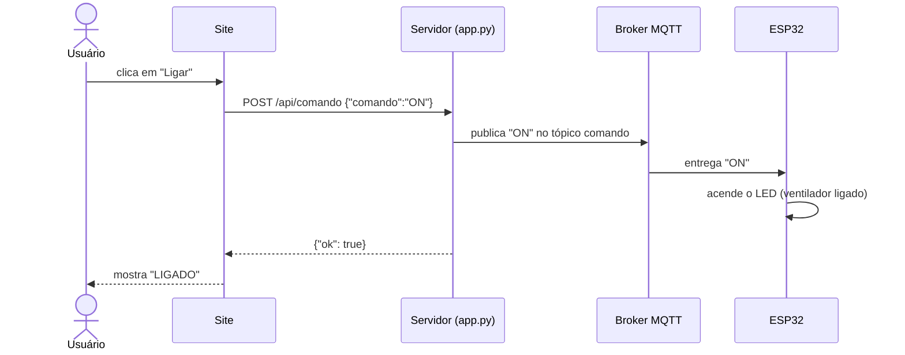
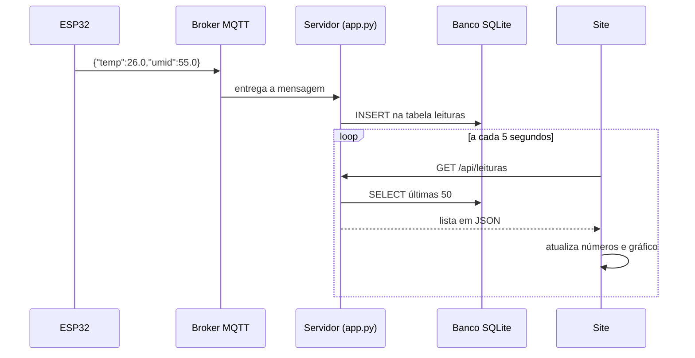

# Entrega 3 – Sistema Web e Dashboard

## 1. O que foi feito

- **Aplicação web** (Flask) ligada ao banco de dados SQLite.
- **Dashboard** que mostra temperatura, umidade e estado do ventilador, e se atualiza sozinho a cada 5 s.
- **Gráfico** com as últimas 50 leituras.
- **Botões** para ligar e desligar o ventilador remotamente.

## 2. Como é a tela

```
┌──────────────────────────────────────────────────┐
│           🌡️ Monitor de Ambiente IoT             │
│                                                  │
│  ┌───────────┐  ┌───────────┐  ┌──────────────┐  │
│  │Temperatura│  │  Umidade  │  │  Ventilador  │  │
│  │   26.0    │  │   55.0    │  │   LIGADO     │  │
│  │    °C     │  │     %     │  │[Ligar][Desl.]│  │
│  └───────────┘  └───────────┘  └──────────────┘  │
│                                                  │
│  ┌────────────────────────────────────────────┐  │
│  │  📈 gráfico: linha vermelha = temperatura  │  │
│  │            linha azul     = umidade        │  │
│  └────────────────────────────────────────────┘  │
└──────────────────────────────────────────────────┘
```

## 3. As rotas (os "endereços" do servidor)

| Endereço | Tipo | O que faz |
|---|---|---|
| `/` | GET | Abre o site (dashboard) |
| `/api/leituras` | GET | Devolve as últimas 50 leituras e o estado do ventilador |
| `/api/comando` | POST | Recebe `{"comando": "ON"}` ou `{"comando": "OFF"}` e repassa ao ESP32 |

Exemplo de resposta de `/api/leituras`:
```json
{
  "leituras": [
    {"data_hora": "2026-11-11 14:30:05", "temp": 26.0, "umid": 55.0}
  ],
  "ventilador": "OFF"
}
```

## 4. O caminho de um clique no botão "Ligar"



## 5. O caminho de uma leitura até a tela



> 📸 **Para a entrega:** print do dashboard com o gráfico preenchido + print do Wokwi com o LED aceso logo após clicar em "Ligar".
