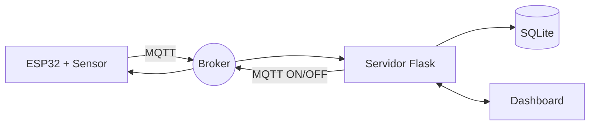

# Entrega 4 – Relatório Técnico Final

**Projeto:** Monitor de Ambiente IoT
**Disciplina:** Tema Integrador IV – Internet das Coisas
**Curso:** Tecnologia em Análise e Desenvolvimento de Sistemas
**Aluno(a):** João Vitor Blummer Belo  ·  **Repositório:** _[link do GitHub]_  ·  **Vídeo:** _[link do vídeo]_

---

## 1. Resumo

Este projeto criou um sistema de Internet das Coisas que mede a temperatura e a umidade de um ambiente, guarda as medidas num banco de dados, mostra os valores num site e permite ligar ou desligar um ventilador à distância. Todo o sistema usa ferramentas gratuitas, e o hardware é simulado no Wokwi.

## 2. Introdução e problema

Ambientes fechados ficam quentes e abafados sem que as pessoas percebam a tempo, o que causa desconforto e cansaço. A IoT permite que objetos do mundo físico (um sensor, um ventilador) se conectem à internet para que possamos **observar** e **agir** à distância.

**Objetivo:** construir a solução mais simples possível que cubra o ciclo completo da IoT: **sensor → rede → banco de dados → site → atuador**.

## 3. Arquitetura

| Camada | Tecnologia | Função |
|---|---|---|
| Borda | ESP32 + DHT22 + LED (Wokwi) | Medir e agir |
| Comunicação | MQTT (broker.hivemq.com) | Transportar mensagens |
| Dados | SQLite | Guardar o histórico |
| Aplicação | Python + Flask | Ligar tudo e servir o site |
| Interface | HTML + Chart.js | Mostrar e controlar |

Os diagramas detalhados estão em `entrega1-concepcao.md`, `entrega2-borda.md` e `entrega3-web.md`.

## 4. Desenvolvimento

1. **Concepção:** problema, casos de uso, requisitos e arquitetura.
2. **Borda:** firmware no Wokwi enviando leituras via MQTT a cada 5 s; servidor gravando no SQLite.
3. **Web:** dashboard com atualização automática, gráfico e botões de controle.
4. **Final:** documentação, testes e vídeo.

**Tamanho do código:** cerca de 100 linhas no firmware, 100 no servidor e 100 no site.

## 5. Testes realizados

| # | Teste | Resultado esperado | Resultado |
|---|---|---|---|
| 1 | Dar Play no Wokwi | ESP32 conecta no Wi-Fi e no broker | ✅ |
| 2 | Aguardar 5 s | Leitura aparece no terminal do servidor e no banco | ✅ |
| 3 | Abrir o site | Mostra valores e gráfico | ✅ |
| 4 | Mudar temperatura no DHT22 do Wokwi | Gráfico acompanha a mudança | ✅ |
| 5 | Clicar em "Ligar" | LED acende no Wokwi | ✅ |
| 6 | Clicar em "Desligar" | LED apaga no Wokwi | ✅ |

_(Marque cada item depois de testar e coloque os prints aqui.)_

## 6. Dificuldades e soluções

| Dificuldade | Solução |
|---|---|
| O Wokwi não consegue acessar o `localhost` do computador | Usar um broker MQTT público como intermediário |
| Banco de dados exigiria instalar um servidor (MySQL) | Usar SQLite, que é só um arquivo |
| Não ter a placa física | Simulador Wokwi, gratuito e fiel ao hardware real |

## 7. Limitações e melhorias futuras

- **Segurança:** o broker público não tem senha; num produto real seria usado um broker privado com TLS e login.
- O estado do ventilador fica na memória do servidor; se o servidor reiniciar, ele volta para "desligado".
- Possíveis melhorias: ligar o ventilador automaticamente acima de certa temperatura, alertas por e-mail, login no site e uso de placa física.

## 8. Conclusão

O projeto mostrou na prática o ciclo completo da IoT de forma simples e funcional: um dispositivo **coleta** dados, a rede **transporta**, o banco **armazena**, o site **mostra** e o usuário **age** à distância. A escolha de ferramentas leves (Wokwi, MQTT, Flask, SQLite) permitiu entregar um sistema que funciona com pouco código e custo zero.

---

## Roteiro do vídeo (5 a 7 minutos)

| Tempo | O que mostrar | O que falar |
|---|---|---|
| 0:00–0:45 | Você ou o README | Problema e ideia do projeto |
| 0:45–1:45 | Diagrama de arquitetura | As 4 peças e o "carteiro" MQTT |
| 1:45–2:45 | Wokwi: circuito e código | Sensor, LED e envio a cada 5 s |
| 2:45–3:30 | Terminal com `python app.py` | Dados chegando e sendo salvos |
| 3:30–4:30 | Dashboard | Números e gráfico; mexer no sensor no Wokwi e mostrar o gráfico mudando |
| 4:30–5:30 | Clicar em Ligar/Desligar | LED acendendo e apagando no Wokwi (tela dividida) |
| 5:30–6:00 | DB Browser | Tabela `leituras` preenchida; encerramento |
